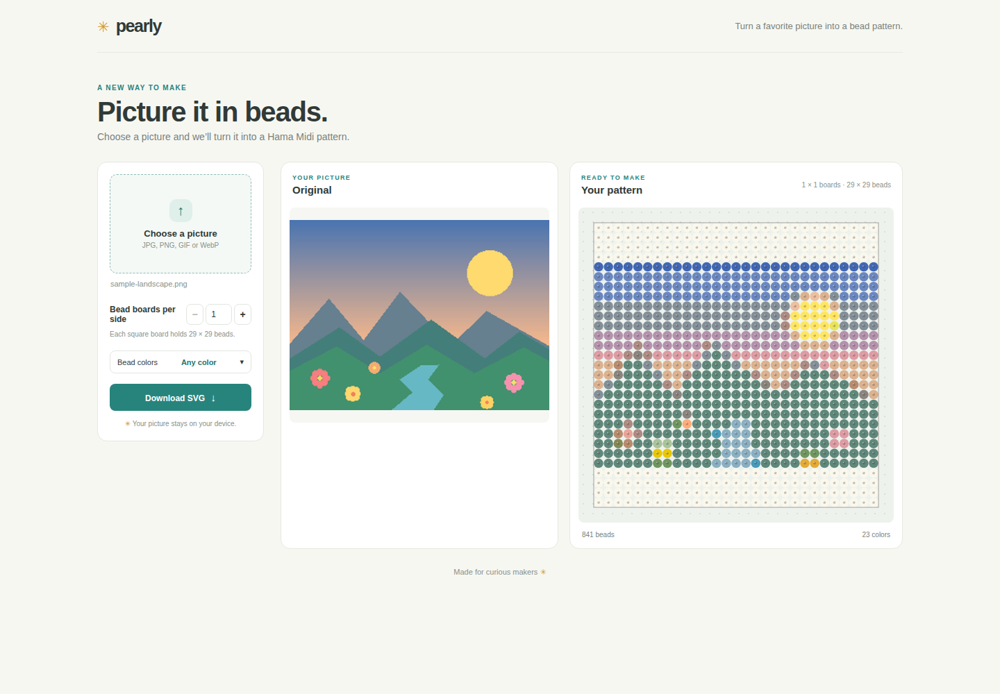

# Pearly ✳

**[Try Pearly in your browser →](https://mathiasstokholm.github.io/Pearly)**

**Picture it in beads.** Pearly turns a favorite picture into a colorful Hama Midi bead pattern, ready to make.



## Make a pattern

Choose a picture, set how many 29 × 29 bead boards to use on each side, and optionally choose which bead colors are available. Pearly previews the original and the pattern, then lets you download the result as an SVG.

Your picture stays on your device; it is processed in your browser.

## Run locally

Install the WebAssembly target and matching `wasm-bindgen` CLI, then build the app:

```sh
rustup target add wasm32-unknown-unknown
cargo install wasm-bindgen-cli --version 0.2.129 --locked
cargo build --profile wasm-release --target wasm32-unknown-unknown
wasm-bindgen --target web --out-dir pkg target/wasm32-unknown-unknown/wasm-release/pearly.wasm
```

Serve the project root over HTTP—for example, with Python:

```sh
python3 -m http.server 8000
```

Open [http://localhost:8000](http://localhost:8000) in your browser.
